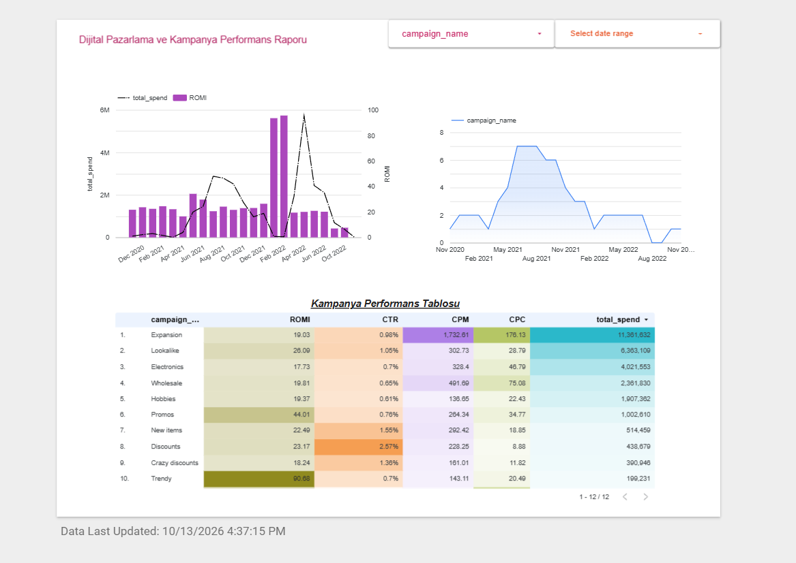

# Marketing Performance Analytics

**SQL · PostgreSQL · Google BigQuery · GA4 · Looker Studio · Google Ads · Facebook Ads**

An end-to-end marketing analytics workflow: combining Google Ads and Facebook Ads data in PostgreSQL to calculate campaign KPIs, building session-level funnel datasets from raw GA4 event data in BigQuery, and reporting campaign performance in a Looker Studio dashboard.

🔗 **[Live Looker Studio dashboard](https://datastudio.google.com/reporting/c190af5f-8bbc-4945-b4fd-cb1e21419735)**



---

## Business Questions

- Which campaigns and media sources deliver the best return on ad spend?
- How do CTR, CPC, CPM, and ROMI change over time and by campaign?
- Where do users drop off between the first session and the purchase?
- Which landing pages convert sessions into purchases best?

---

## Data

| Source | Tool | Tables |
| --- | --- | --- |
| Advertising data (Facebook Ads + Google Ads, daily) | PostgreSQL | `facebook_ads_basic_daily`, `facebook_campaign`, `facebook_adset`, `google_ads_basic_daily` |
| Website event data (GA4) | BigQuery | `bigquery-public-data.ga4_obfuscated_sample_ecommerce.events_*` (2021) |

---

## Part 1 — Advertising Campaign Performance (PostgreSQL)

Facebook Ads and Google Ads data are stored in different tables with different structures. Each query first unifies both sources with `UNION ALL`, then aggregates to the level needed for the business question.

| Query | What it answers |
| --- | --- |
| [`daily_media_source_aggregates.sql`](sql/daily_media_source_aggregates.sql) | Daily spend, impressions, clicks, and conversion value per media source (Facebook vs. Google) |
| [`daily_media_campaign_adset_breakdown.sql`](sql/daily_media_campaign_adset_breakdown.sql) | The same metrics broken down by campaign and ad set, after joining Facebook campaign and ad set names |
| [`facebook_campaign_performance_metrics.sql`](sql/facebook_campaign_performance_metrics.sql) | Daily CPC, CPM, CTR %, and ROMI % per Facebook campaign |
| [`daily_utm_campaign_metrics.sql`](sql/daily_utm_campaign_metrics.sql) | Daily KPIs per campaign across both platforms, with the campaign name parsed from the URL's `utm_campaign` parameter |
| [`daily_utm_campaign_metrics_facebook_google.sql`](sql/daily_utm_campaign_metrics_facebook_google.sql) | Final version of the UTM-based campaign metrics table used as the dashboard source |

**Techniques:** CTEs, `UNION ALL` across platforms, `LEFT JOIN` to dimension tables, regex extraction with `SUBSTRING(... FROM 'utm_campaign=([^&]+)')`, cleaning `'nan'` values to `NULL`, `COALESCE` for missing values, and `NULLIF` / `CASE` to avoid division by zero.

Query results are in [`sample_outputs/`](sample_outputs/).

### Metric definitions

All ratio metrics are calculated from summed totals (ratio of sums), not by averaging daily ratios:

| Metric | Formula |
| --- | --- |
| CTR | clicks / impressions |
| CPC | spend / clicks |
| CPM | spend / impressions × 1,000 |
| ROMI | (conversion value − spend) / spend |

---

## Part 2 — GA4 Event Data Analysis (BigQuery)

GA4 stores data at event level, with session IDs and other details inside nested `event_params` arrays.

1. **BI-ready dataset:** Extracted `ga_session_id` with `UNNEST(event_params)`, converted timestamps, and kept country, device category, and traffic source (source, medium, campaign) for the key funnel events.
2. **Funnel analysis:** Built session-level funnel steps from `session_start` and `view_item` through to `purchase` and calculated step-by-step conversion rates.
3. **Landing page conversion:** Compared how sessions starting on different landing pages convert into purchases.
4. **Engagement vs. purchase:** Analyzed the relationship between user engagement and purchases.

**Techniques:** `UNNEST()` on nested and repeated fields, event parameter extraction, `_TABLE_SUFFIX` date filtering on wildcard tables, session-level aggregation.

BigQuery saved queries: [query 1](https://console.cloud.google.com/bigquery?sq=830535510918:fab2665ece064a72b339856ef8ddc542) · [query 2](https://console.cloud.google.com/bigquery?sq=830535510918:44ed0ede951048e69f54ea6fe873063e) (requires a Google Cloud login)


---

## Part 3 — Looker Studio Dashboard

The **Dijital Pazarlama ve Kampanya Performans Raporu** (Digital Marketing & Campaign Performance Report) includes:

- **Monthly spend vs. ROMI** (combo chart) to see whether higher spend comes with higher or lower returns
- **Number of active campaigns over time**
- **Campaign performance table** with ROMI, CTR, CPM, CPC, and total spend per campaign
- **Filters** for campaign name and date range

---

## Key Findings

| Campaign | Total spend | ROMI | CTR | CPC |
| --- | ---: | ---: | ---: | ---: |
| Expansion | 11,361,632 | 19.0% | 0.98% | 176.13 |
| Lookalike | 6,363,109 | 26.1% | 1.05% | 28.79 |
| Electronics | 4,021,553 | 17.7% | 0.70% | 46.79 |
| Promos | 1,002,610 | 44.0% | 0.76% | 34.77 |
| Discounts | 438,679 | 23.2% | 2.57% | 8.88 |
| Trendy | 199,231 | 90.7% | 0.70% | 20.49 |

*Selected campaigns from the dashboard table (12 campaigns in total).*

1. **The biggest budgets earn the lowest returns.** Expansion has the largest spend (11.4M) but only 19.0% ROMI, and Electronics (4.0M) returns just 17.7%.
2. **Clicks on Expansion are expensive.** Its CPC (176.13) is about 20× that of Discounts (8.88).
3. **Small campaigns show the highest returns.** Trendy reaches 90.7% ROMI on under 2% of Expansion's budget, and Promos reaches 44.0%.
4. **Discounts has the most engaging ads among the top 10 campaigns by spend.** Its CTR is 2.57%, compared with 0.98% for Expansion.

### Recommendation

Test moving part of the budget from low-ROMI, high-CPC campaigns (Expansion, Electronics) to high-ROMI campaigns (Trendy, Promos) in controlled steps. Track whether ROMI holds as spend increases, because returns seen on a small budget often shrink at larger scale.

---

## Project Structure

```text
marketing-performance-analytics/
├── sql/              # PostgreSQL queries (Part 1)
├── sample_outputs/   # Query result screenshots
├── bigquery/         # Links to BigQuery saved queries (Part 2)
├── looker-studio/    # Dashboard link and screenshot (Part 3)
├── screenshots/      # BigQuery screenshots
└── README.md
```

---

## Skills Demonstrated

- Combining multi-platform advertising data into one analytical model
- Calculating marketing KPIs (CTR, CPC, CPM, ROMI)
- Parsing UTM parameters with SQL
- Working with the GA4 event-based data model in BigQuery
- Funnel and landing page conversion analysis
- Building an interactive marketing dashboard in Looker Studio
